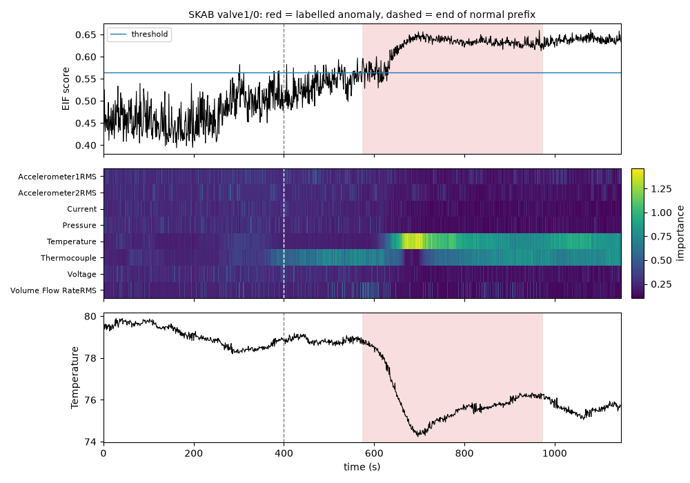
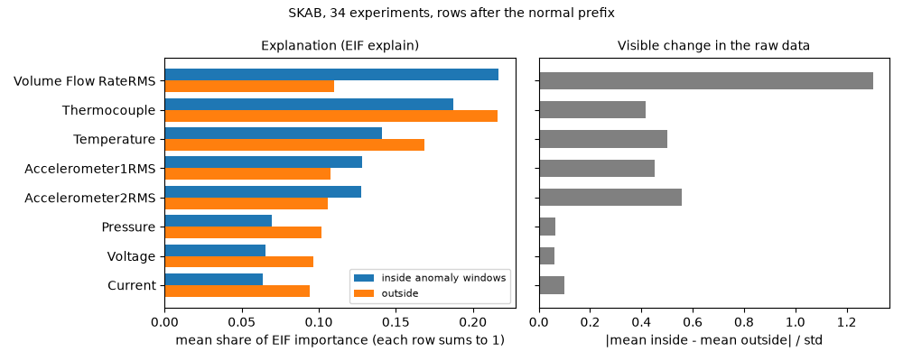

# XAD-Stream

[](https://github.com/EminnKurtt/xad-stream/actions/workflows/ci.yml)

Explainable anomaly detection on industrial sensor data, evaluated on the public SKAB benchmark.

Industrial machines are monitored by many sensors, and faults are rare and often unlabelled.
An alarm is more useful when it also says *which sensors* look wrong. XAD-Stream fits
unsupervised isolation-based detectors to normal operation and flags deviations. It also
attributes each anomaly score to individual sensors, and it checks honestly whether those
attributions point to the sensors that actually change.

## Results

Mean over the 34 labelled SKAB experiments, computed on the rows after each experiment's
normal prefix. Both models use the same protocol (see Method). The reference row flags every
row as anomalous: more than half of the evaluated rows are anomalous, so any useful detector
has to beat it.

| model | precision | recall | F1 | ROC AUC |
|---|---|---|---|---|
| Isolation Forest | 0.702 | 0.521 | 0.563 | 0.732 |
| Extended Isolation Forest | 0.696 | 0.890 | 0.770 | 0.796 |
| flag every row (reference) | 0.542 | 1.000 | 0.702 | 0.500 |

EIF has a higher F1 than Isolation Forest in 29 of 34 experiments.

Most of EIF's F1 gain comes from recall. The threshold-free ROC AUC improves less.
Isolation Forest variants explored earlier, with a stricter 0.99 quantile threshold:

| Isolation Forest variant (0.99 quantile) | precision | recall | F1 | ROC AUC |
|---|---|---|---|---|
| 8 sensors, threshold on training scores | 0.740 | 0.419 | 0.498 | 0.742 |
| 8 sensors, threshold on held-out 25 % | 0.720 | 0.316 | 0.397 | 0.732 |
| 8 sensors + 30 s rolling mean/std | 0.603 | 0.346 | 0.355 | 0.733 |

Rolling-window features did not help, and neither did a held-out threshold at this quantile.
Per-experiment numbers are in [`docs/`](docs/), and the full write-up is in
[`docs/results.md`](docs/results.md).

### Explanations



For `valve1/0`, Temperature importance rises during the labelled temperature drop.
Thermocouple importance is already high before the anomaly, because the sensor drifts away
from the short training window and pushes the score towards the threshold.



Across all experiments the result is mixed:

- **Volume Flow RateRMS** changes most visibly, and its share of importance roughly doubles
  inside anomaly windows (0.110 outside, 0.217 inside).
- **Pressure, Voltage and Current** barely change, and they get the lowest share.
- **Temperature and Thermocouple** get high importance everywhere, so their importance does
  not single out the anomaly windows.

## Method

- **Data protocol, per experiment.** Each SKAB experiment starts with normal operation. The
  first rows (up to 400, ending 5 rows before the first labelled anomaly) are the
  known-normal prefix. The model is fit on the first 75 % of the prefix, after
  standardisation on the same rows.
- **Threshold calibration.** The alarm threshold is the 0.95 quantile of the scores on the
  held-out last 25 % of the prefix. In-sample scores are optimistically low.
- **Evaluation.** Metrics are computed on all rows after the prefix, per experiment, and then
  averaged.
- **Models.**
  - **Isolation Forest:** scikit-learn, 200 trees.
  - **Extended Isolation Forest:** implemented from scratch in
    [`src/xad/eif.py`](src/xad/eif.py), 200 trees, fully extended. It splits on random
    hyperplanes instead of single features (Hariri et al.).
- **Explanations.** `ExtendedIsolationForest.explain` gives a per-sensor importance for every
  row. At each split on the row's path, each sensor gets its share of the split value
  `|n_k (x_k - p_k)|`. That share is weighted by how strongly the split isolates the row
  (`1 - size(child) / size(node)`), and the result is averaged over trees.

  **What it is not:** this is a simplified heuristic *inspired by* ExIFFI. It is not a
  reimplementation of ExIFFI or DIFFI, and it has not been validated beyond the checks in
  [`docs/results.md`](docs/results.md).

## Limitations

- **Per-experiment fitting.** Every experiment gets its own model, fit on its own beginning.
  This is not one model deployed across runs.
- **Short normal prefix.** At most 400 rows (400 s at 1 Hz), and only 75 % of them for
  fitting. Slow drift after the prefix causes false alarms, and it inflates the
  importance of drifting sensors.
- **Simplified explanations.** See above. The check against "visible change" uses a simple
  mean difference, which misses changes in variance or in correlations.
- **High anomaly rate.** About half of the evaluated rows are anomalous, so F1 must be read
  against the flag-everything reference.
- **No streaming yet.** Scoring is offline, on whole recorded experiments.

## Reproduce

```bash
make install                          # in a Python 3.11+ virtualenv
make data                             # clones SKAB into data/raw/SKAB (not committed)
make test && make lint
python scripts/run_baseline.py        # docs/baseline_*.csv
python scripts/compare_models.py      # docs/compare_if_vs_eif*.csv (under a minute)
python scripts/explain_skab.py        # docs/explanation_* figures and CSVs
python scripts/results_table.py       # the README tables, from the CSVs
bash scripts/check_project.sh         # tests, lint, clean tree, README matches CSVs
```

All runs are seeded. The tests use synthetic data and do not need SKAB.

## Data and attribution

[SKAB, the Skoltech Anomaly Benchmark](https://github.com/waico/SKAB) (Katser and Kozitsin,
2020) records 8 sensors at 1 Hz on a water-circulation test bench. SKAB is licensed under
**GPL-3.0**. This repository **downloads it at build time and does not redistribute it**.
Dataset notes are in [`docs/data.md`](docs/data.md).

## Roadmap

- Streaming replay: a producer sends a SKAB experiment to a Redpanda topic, and a consumer
  scores each row with the fitted EIF and logs alarms with their top sensors.
- Docker Compose setup for the streaming demo.
- A small dashboard for scores, alarms and sensor importance.

## References

- S. Hariri, M. Carrasco Kind, R. J. Brunner. *Extended Isolation Forest.* IEEE Transactions
  on Knowledge and Data Engineering, doi:10.1109/TKDE.2019.2947676.
  [arXiv:1811.02141](https://arxiv.org/abs/1811.02141)
- A. Arcudi, D. Frizzo, C. Masiero, G. A. Susto. *Enhancing Interpretability and
  Generalizability in Extended Isolation Forests* (introduces ExIFFI).
  [arXiv:2310.05468](https://arxiv.org/abs/2310.05468)
- M. Carletti, M. Terzi, G. A. Susto. *Interpretable Anomaly Detection with DIFFI:
  Depth-based Isolation Forest Feature Importance.*
  [arXiv:2007.11117](https://arxiv.org/abs/2007.11117)
- SKAB: https://github.com/waico/SKAB

## License

MIT for the code in this repository (see [LICENSE](LICENSE)). SKAB keeps its own GPL-3.0
licence.
